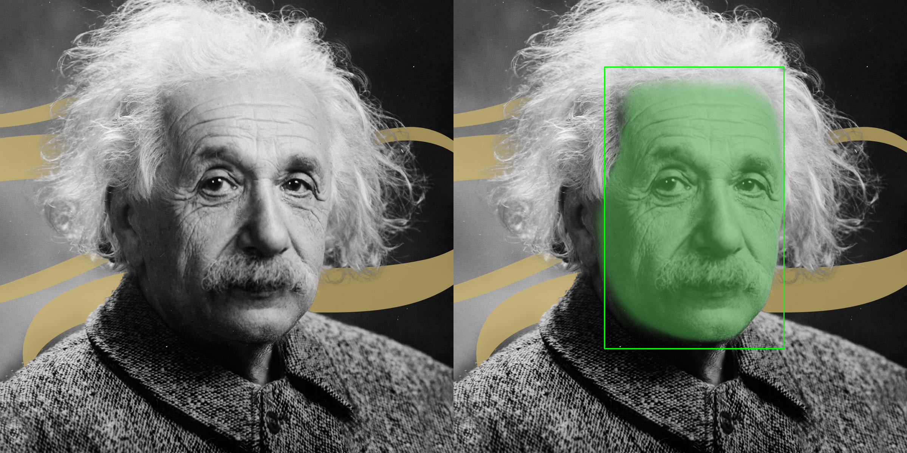

# Face Segmentation

[](https://www.python.org/downloads/)
[](LICENSE)
[](https://github.com/yakhyo/face-segmentation/releases)

> [!TIP]
> The models and functionality in this repository are **integrated into [UniFace](https://github.com/yakhyo/uniface)** — an all-in-one face analysis library.
> [](https://pypi.org/project/uniface/) [](https://github.com/yakhyo/uniface/stargazers) [](https://opensource.org/licenses/MIT)

Face segmentation using XSeg model from [DeepFaceLab](https://github.com/iperov/DeepFaceLab) with [UniFace](https://github.com/yakhyo/uniface) for face detection and alignment. Automatically detects faces and generates pixel-accurate segmentation masks.

<div align="center">
  
</div>

## Installation

```bash
pip install -r requirements.txt
```

## Download Weights

Download the pre-trained XSeg ONNX model:

| Model | Size | Download |
|-------|------|----------|
| XSeg | 67 MB | [xseg.onnx](https://github.com/yakhyo/face-segmentation/releases/download/weights/xseg.onnx) |

Place the downloaded model in the `weights/` directory.

## Usage

```bash
python main.py --model weights/xseg.onnx --image assets/einstien.png
```

**Options:**
| Argument | Default | Description |
|----------|---------|-------------|
| `--model` | required | Path to XSeg ONNX model |
| `--image` | `assets/einstien.png` | Input image path |
| `--output` | `None` | Output image path |
| `--blur` | `0` | Gaussian blur sigma for mask smoothing |
| `--align-size` | `256` | Face alignment size |

## Outputs

The script generates:
- `*_xseg_result.png` - Image with mask overlay
- `*_xseg_mask.png` - Binary segmentation mask
- `*_xseg_comparison.png` - Side-by-side comparison
- `*_aligned_crop.png` - Aligned face crop

## References

- [UniFace](https://github.com/yakhyo/uniface) - Face detection and alignment
- [XSeg ONNX Model](https://huggingface.co/CountFloyd/deepfake) - Face Segmentation model used in DeepFaceLab

## License

[GNU General Public License v3.0](LICENSE)
